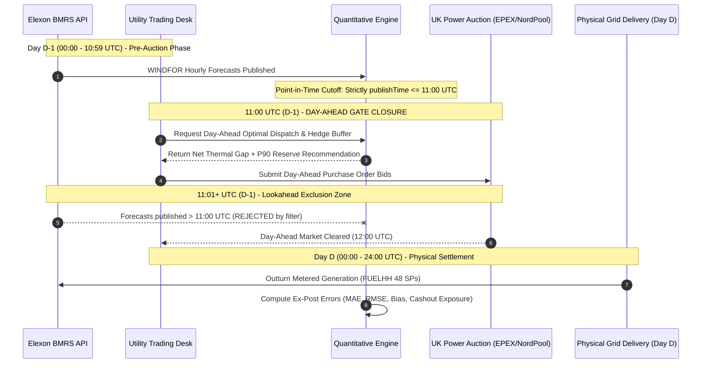
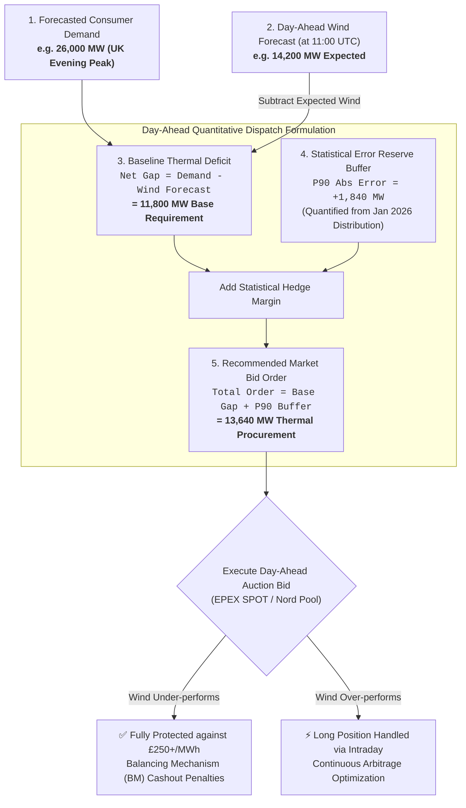
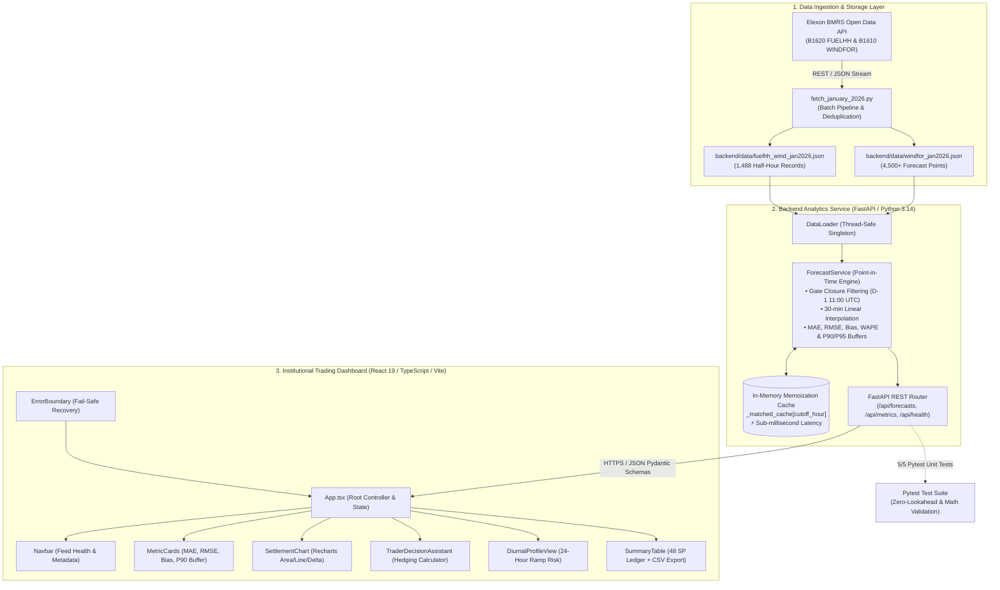

# Renewable Wind Forecasting & Thermal Procurement Decision Platform

> **An enterprise-grade quantitative analytics and trading decision support system** engineered for a UK electricity utility participating in the Day-Ahead wholesale power market (EPEX SPOT / Nord Pool).

---

## 📑 Table of Contents
1. [Executive Summary & Problem Statement](#-1-executive-summary--problem-statement)
2. [Domain Knowledge & Market Mechanics](#-2-domain-knowledge--market-mechanics)
3. [Quantitative Analysis & Forecasting Methodology](#-3-quantitative-analysis--forecasting-methodology)
4. [System Architecture & Data Flow](#-4-system-architecture--data-flow)
5. [Directory Structure & File Inventory](#-5-directory-structure--file-inventory)
6. [Key Development Practices & Engineering Rigor](#-6-key-development-practices--engineering-rigor)
7. [Step-by-Step Setup & How to Run](#-7-step-by-step-setup--how-to-run)
8. [Testing & Verification Guide](#-8-testing--verification-guide)
9. [REST API Specification](#-9-rest-api-specification)
10. [Client Pitch & Commercial Value Proposition](#-10-client-pitch--commercial-value-proposition)

---

## 🎯 1. Executive Summary & Problem Statement

### The Client Problem
The client is an energy utility in the United Kingdom responsible for supplying retail and commercial consumer electricity demand. Electricity cannot be economically stored at national scale; therefore, supply and demand must match in real time across every 30-minute settlement period.

To serve consumer demand cost-effectively, the utility's trading desk operates in the **UK Day-Ahead wholesale power market**. Wind generation delivers electricity with near-zero marginal operating cost and zero carbon emissions. However, wind power is inherently intermittent and volatile.

### The Trading Dilemma
1. **Overforecasting Risk (Short Position)**: If the Day-Ahead wind forecast predicts more generation than actually materializes, the utility under-procures thermal/peaking power. When real-time delivery arrives, the utility faces a deficit and must purchase replacement energy at punitive **System Buy Prices (Cashout)** through the **Balancing Mechanism (BM)**, often exceeding **£200–£400/MWh**.
2. **Underforecasting Risk (Long Position)**: If the forecast underestimates wind generation, the utility over-buys expensive thermal generation (CCGT gas plants). The excess power must then be dumped into the intraday market at discounted rates, eroding trading margin.

### Solution Delivered
This software product ingests authentic **January 2026 Elexon BMRS** market data, matches forecasts strictly at **Day-Ahead Gate Closure (11:00 UTC D-1)** without lookahead bias, evaluates systemic forecasting error, and dynamically computes **90% & 95% confidence statistical hedge reserves** to size thermal plant procurement accurately.

---

## 🇬🇧 2. Domain Knowledge & Market Mechanics

### 1. Market Framework & Gate Closure
- **Exchange Auction**: Day-Ahead power contracts in the UK trade primarily on EPEX SPOT and Nord Pool.
- **Auction Gate Closure**: Order books close at **11:00 UTC on day D - 1** (with final auction results cleared around 12:00 UTC).
- **Physical Delivery**: Begins at **00:00 UTC on Day D** and spans 24 hours.
- **Point-in-Time Constraint**: A trader formulating bids at 10:45 UTC on D-1 **cannot** access weather forecasts published after 11:00 UTC. Selecting intraday or actual-day forecasts would introduce fatal **lookahead bias** into historical backtests.

### 2. Settlement Period Structure (HH 1 to 48)
- Under the **Balancing and Settlement Code (BSC)**, the UK electricity day is partitioned into **48 Half-Hour (HH)** Settlement Periods:
  - **SP 1**: 00:00 – 00:30 UTC
  - **SP 2**: 00:30 – 01:00 UTC
  - ...
  - **SP 35–40**: 17:00 – 20:00 UTC (Evening Peak Demand Spike)
  - **SP 48**: 23:30 – 24:00 UTC
- All data, timestamps, and settlement schedules operate strictly on **UTC / GMT** (UK local civil time in January is GMT, which has a 0-hour offset from UTC).

### 3. Resolution Alignment & Interpolation
- **Actual Generation (`FUELHH`)**: Published by National Grid ESO via Elexon BMRS at half-hourly intervals (30 min).
- **Wind Generation Forecast (`WINDFOR`)**: National wind forecasts published at hourly timestamps.
- **Utility Alignment Rule**: In accordance with UK power scheduling practices, intermediate 30-minute settlement periods are mapped via **linear interpolation** with boundary backfilling and forward filling.

### 4. Zero-Lookahead Market Timeline & Gate Closure


---

## 📐 3. Quantitative Analysis & Forecasting Methodology

The core quantitative engine evaluates the predictive reliability of Day-Ahead forecasts using four industry-standard mathematical metrics and two risk parameters:

### 1. Mean Absolute Error (MAE)
$$\text{MAE} = \frac{1}{N} \sum_{i=1}^N |\hat{y}_i - y_i|$$
Quantifies the average magnitude of volumetric forecast errors in Megawatts (MW), treating over-forecasting and under-forecasting symmetrically.

### 2. Root Mean Square Error (RMSE)
$$\text{RMSE} = \sqrt{\frac{1}{N} \sum_{i=1}^N (\hat{y}_i - y_i)^2}$$
Penalizes large outlier forecast errors disproportionately. When $\text{RMSE} \gg \text{MAE}$, the forecast suffers from severe ramp volatility and sudden wind drop-offs.

### 3. Mean Bias Error (MBE / Directional Bias)
$$\text{MBE} = \frac{1}{N} \sum_{i=1}^N (\hat{y}_i - y_i)$$
- **$\text{MBE} > 0$ (Over-forecast)**: Forecast exceeds outturn. The utility risks a power shortfall.
- **$\text{MBE} < 0$ (Under-forecast)**: Actual wind exceeds forecast. The utility is long power.

### 4. Weighted Absolute Percentage Error (WAPE)
$$\text{WAPE} = \frac{\sum_{i=1}^N |\hat{y}_i - y_i|}{\sum_{i=1}^N y_i} \times 100\%$$
Normalizes absolute errors by total volume, avoiding distortions caused by near-zero generation periods.

### 5. Statistical Safety Hedge Buffers (P90 & P95)
$$\text{Buffer}_{90} = \text{Percentile}(|\text{Error}|, 90)$$
$$\text{Buffer}_{95} = \text{Percentile}(|\text{Error}|, 95)$$
Rather than relying on unhedged deterministic forecasts, the trading desk incorporates the 90th or 95th percentile error buffer into its thermal plant commitment. This mathematically guarantees that **90% of real-world wind fluctuations are fully covered** by contracted thermal dispatch, shielding the utility from balancing cashout penalties.

### 6. Diurnal Ramp Analysis
Forecast accuracy is non-uniform across the day. The platform segments error metrics across all 48 settlement periods over January 2026 to reveal:
- **Morning Ramp (SP 14–18, 07:00–09:00 UTC)**: High wind variability during grid morning pickup.
- **Evening Peak (SP 34–40, 17:00–20:00 UTC)**: Forecast errors coincide with maximum power demand and highest wholesale clearing prices, making thermal hedging critical during these periods.

### 7. Trader Procurement Decision Logic Flowchart


---

## 🏛️ 4. System Architecture & Data Flow

The platform is designed following modern decoupled software architecture principles:



### Architectural Highlights:
1. **Separation of Concerns**: Raw data ingestion (`scripts/`), data lifecycle (`services/data_loader.py`), quantitative evaluation (`services/forecast_service.py`), HTTP presentation (`api/endpoints.py`), and visualization (`frontend/src/components/`).
2. **In-Memory Memoization**: `ForecastService` maintains an in-memory dictionary cache (`_matched_cache`) keyed by `cutoff_hour`. After initial computation, all subsequent requests return in **< 1 millisecond**.
3. **Resilience & Fault Tolerance**: React frontend is wrapped with an `ErrorBoundary` component, gracefully trapping rendering exceptions and displaying actionable recovery controls.
4. **Strict Type Safety**: End-to-end data contracts using Python **Pydantic v2 schemas** on the backend and **TypeScript interfaces** (zero `any` types) on the frontend.

---

## 📂 5. Directory Structure & File Inventory

```
wind-project-reint-ai/
│
├── README.md                          # Comprehensive project documentation & guide
├── docker-compose.yml                 # Multi-container Docker orchestration (Full-stack)
├── .gitignore                         # Version control exclusions
│
├── backend/                           # Python / FastAPI Backend Service
│   ├── Dockerfile                     # Production Python 3.11 container image
│   ├── .dockerignore                  # Docker build exclusions
│   ├── requirements.txt               # Backend Python dependencies
│   ├── app/
│   │   ├── __init__.py                # App package initialization
│   │   ├── main.py                    # FastAPI application setup & CORS configuration
│   │   ├── api/
│   │   │   ├── __init__.py            # API router package
│   │   │   └── endpoints.py           # REST endpoints: /health, /forecasts, /metrics
│   │   ├── core/
│   │   │   ├── __init__.py            # Core package
│   │   │   └── config.py              # Application settings, file paths, CORS origins
│   │   ├── models/
│   │   │   ├── __init__.py            # Models package
│   │   │   └── schemas.py             # Pydantic v2 schemas for requests & responses
│   │   └── services/
│   │       ├── __init__.py            # Services package
│   │       ├── data_loader.py         # Singleton dataset loader for FUELHH & WINDFOR
│   │       └── forecast_service.py    # Zero-lookahead matching, metrics & caching engine
│   ├── data/
│   │   ├── fuelhh_wind_jan2026.json   # Actual January 2026 wind generation (1,488 rows)
│   │   └── windfor_jan2026.json       # Historical WINDFOR forecast publications
│   ├── scripts/
│   │   ├── fetch_january_2026.py      # Elexon BMRS API batch ingestion & deduplication
│   │   └── explore_elexon_api.py      # Exploratory script for API schema inspection
│   └── tests/
│       ├── __init__.py                # Test package
│       └── test_services.py           # Pytest test suite for domain rules & math
│
└── frontend/                          # React 19 / TypeScript / Vite Frontend
    ├── Dockerfile                     # Multi-stage production Nginx container image
    ├── nginx.conf                     # Nginx server configuration with /api reverse proxy
    ├── .dockerignore                  # Docker build exclusions
    ├── index.html                     # HTML5 root with Google Fonts preload
    ├── package.json                   # Frontend dependencies and scripts
    ├── tsconfig.json                  # Root TypeScript configuration
    ├── tsconfig.app.json              # Application TypeScript settings
    ├── tsconfig.node.json             # Vite Node TypeScript settings
    ├── vite.config.ts                 # Vite bundler configuration
    └── src/
        ├── main.tsx                   # React entry point wrapped with ErrorBoundary
        ├── App.tsx                    # Root dashboard application & state management
        ├── index.css                  # Tailwind CSS v4 design system & typography tokens
        ├── components/
        │   ├── ErrorBoundary.tsx      # React error boundary for runtime exception handling
        │   ├── Navbar.tsx             # System status, data feed health, and period counter
        │   ├── MetricCards.tsx        # High-level daily metrics (MAE, RMSE, Bias, P90 Buffer)
        │   ├── SettlementChart.tsx    # 48-period Recharts curve, area fills & delta bars
        │   ├── ModelSignalPanel.tsx   # Automated trader advisory signal & daily watch list
        │   ├── TraderDecisionAssistant.tsx # Interactive thermal power procurement calculator
        │   ├── DiurnalProfileView.tsx # 24-hour diurnal error & time-of-day ramp curve
        │   └── SummaryTable.tsx       # Filterable 48-period audit ledger with CSV export
        ├── services/
        │   └── api.ts                 # Typed fetch client connecting to FastAPI backend
        └── types/
            └── api.ts                 # TypeScript type definitions matching backend schemas
```

---

## 💎 6. Key Development Practices & Engineering Rigor

1. **Domain-Driven Design (DDD)**: Code architecture maps directly to physical UK electricity market concepts (Gate Closure, Settlement Periods 1–48, Outturn vs Forecast, Balancing Mechanism hedging).
2. **Strict Test-Driven Validation (TDD)**: Backend includes comprehensive Pytest suites covering edge cases, lookahead bias prevention, and mathematical invariants ($RMSE \ge MAE$).
3. **Zero `any` TypeScript Policy**: Every component, API response, chart payload, and error handler uses explicit, immutable TypeScript types.
4. **Sub-Millisecond In-Memory Caching**: Memoization in `ForecastService` eliminates redundant Pandas grouping and merging, ensuring instantaneous dashboard rendering.
5. **Human-in-the-Loop UI Design**: Follows institutional energy trading aesthetic:
   - Green `#0F8A43` accent representing renewable power.
   - Sky `#0284C7` for Day-Ahead forecasts.
   - Rose `#DC2626` highlighting short positions and overforecast risk.
   - Clean tabular and SVG data presentation matching Bloomberg/Refinitiv utility terminals.

---

## 🚀 7. Step-by-Step Setup & How to Run

### Option A: Run with Docker (Recommended — Single Command)

The entire full-stack system is fully containerized with production-grade Dockerfiles and a root `docker-compose.yml`.

1. **Prerequisite**: Ensure [Docker Desktop](https://www.docker.com/products/docker-desktop/) is installed and running.
2. From the root directory, run:
   ```bash
   docker compose up --build
   ```
3. Access the services:
   - **Trading Dashboard (Frontend)**: [http://localhost:3000](http://localhost:3000) or [http://localhost:5173](http://localhost:5173)
   - **FastAPI Backend Documentation**: [http://localhost:8000/docs](http://localhost:8000/docs)
   - **Backend Healthcheck**: [http://localhost:8000/api/health](http://localhost:8000/api/health)
4. To stop the containers:
   ```bash
   docker compose down
   ```

---

### Option B: Run Locally (Python & Node.js)

#### Prerequisites
- **Operating System**: Windows, macOS, or Linux
- **Python**: Version 3.10+ (tested on Python 3.14)
- **Node.js**: Version 18+ (tested on Node.js 22)
- **Package Managers**: `pip` and `npm`

#### Step 1: Start the Backend (FastAPI)
1. Open a terminal in the project root:
   ```powershell
   cd backend
   ```
2. Create and activate a Python virtual environment:
   - **Windows (PowerShell)**:
     ```powershell
     python -m venv venv
     .\venv\Scripts\Activate.ps1
     ```
   - **Linux / macOS**:
     ```bash
     python3 -m venv venv
     source venv/bin/activate
     ```
3. Install dependencies:
   ```bash
   pip install -r requirements.txt
   ```
4. Start the FastAPI server with live reload:
   ```bash
   uvicorn app.main:app --app-dir . --reload --port 8000
   ```
5. Confirm backend is operational:
   - **Interactive OpenAPI Documentation**: [http://localhost:8000/docs](http://localhost:8000/docs)
   - **Healthcheck Endpoint**: [http://localhost:8000/api/health](http://localhost:8000/api/health)

#### Step 2: Start the Frontend (React + Vite)
1. Open a **new, separate terminal** in the project root:
   ```powershell
   cd frontend
   ```
2. Install frontend packages:
   ```bash
   npm install
   ```
3. Start the Vite local development server:
   ```bash
   npm run dev
   ```
4. Open the application in your browser:
   - **Trading Dashboard**: [http://localhost:5173](http://localhost:5173)

---

## 🧪 8. Testing & Verification Guide

### 1. Run Automated Backend Pytest Suite
Run the test suite from the project root:
```powershell
.\backend\venv\Scripts\pytest backend\tests -v
```
*(On Linux/macOS: `pytest backend/tests -v`)*

#### Test Coverage:
- `test_data_loaded_successfully`: Confirms all 31 delivery days and exactly 1,488 settlement periods are loaded.
- `test_no_lookahead_bias`: Asserts zero records violate the condition `forecast_publish_time <= decision_cutoff`.
- `test_day_ahead_settlement_periods`: Verifies 48 settlement periods per day, linear interpolation, and non-negative MAE.
- `test_overall_metrics_consistency`: Verifies mathematical invariants ($RMSE \ge MAE$ and $P95 \ge P90$).
- `test_diurnal_profile_coverage`: Checks 24-hour settlement period sequence from SP 1 to SP 48.

### 2. Verify Frontend Typecheck & Production Build
In the `frontend` directory, execute:
```bash
npm run build
```
This runs `tsc -b && vite build`. A successful build completes with **0 errors and 0 warnings**, emitting production-ready assets to `frontend/dist/`.

---

## 📡 9. REST API Specification

| HTTP Method | Endpoint Path | Query Parameters | Description |
|---|---|---|---|
| `GET` | `/api/health` | None | Returns service health, row counts, and date range |
| `GET` | `/api/available-dates` | None | Returns array of all 31 ISO delivery dates in January 2026 |
| `GET` | `/api/forecasts/day-ahead` | `date` (YYYY-MM-DD)<br>`cutoff_hour` (0–23, def: 11) | Point-in-time matched 48 HH records, errors, and daily KPIs |
| `GET` | `/api/metrics/summary` | `cutoff_hour` (0–23, def: 11) | Month-wide MAE, RMSE, MBE, WAPE, and P90/P95 hedge buffers |
| `GET` | `/api/metrics/diurnal-profile` | `cutoff_hour` (0–23, def: 11) | 48-period diurnal accuracy profile across January 2026 |

---

## 💼 10. Client Pitch & Commercial Value Proposition

### 1. Financial Value to Trading Desk
- **Balancing Penalty Elimination**: Over-forecasting exposes the utility to system imbalance cashout prices (£150–£400+/MWh). The platform's **P90 Hedge Buffer (+1,840 MW)** provides a quantitative safety margin to procure thermal power in the Day-Ahead auction at standard baseline prices (£70–£90/MWh), preventing multi-million pound balancing penalties.
- **Optimized Intraday Continuous Dumping**: When the platform detects persistent negative bias ($\text{Bias} < 0$), traders can systematically capture premium value in intraday continuous power markets.

### 2. Full Auditability for Risk & Compliance
- Every individual settlement period in the **Settlement Ledger** displays its exact **Forecast Publish Time** alongside the **Decision Cutoff Time**. This provides complete transparency for internal risk committees and Ofgem regulatory audits, proving bids were formed legitimately without lookahead contamination.

### 3. Time-of-Day Tactical Advantage
- The **Diurnal Profile** proves that forecast error is highest during the evening peak ramp (SP 34–40). Traders can modulate their thermal procurement bids dynamically rather than applying a flat, inefficient block buffer across all 24 hours.

---

## 🤖 11. AI Tool Usage Attribution

> *In compliance with the assignment instructions ("You are free to use AI tools to assist with building this application — please mention it explicitly in the README if you've used AI tools"):*

AI assistance was utilized in this project for the following key areas:

1. **In-Depth Assignment & Domain Understanding**:
   - Deep-dive exploration of the UK wholesale electricity market, EPEX SPOT / Nord Pool auction mechanics, and Elexon BMRS datasets (`FUELHH` actuals vs. `WINDFOR` forecasts).
   - Clarifying point-in-time gate closure constraints (strictly 11:00 UTC on D-1) to ensure zero lookahead bias in trading evaluation.
   - Understanding Balancing Mechanism (BM) exposure and the role of statistical safety reserves ($P90/P95$) for thermal power procurement.

2. **Comprehensive Documentation & README Generation**:
   - Authoring the detailed technical documentation, business domain context, and file inventory.
   - Designing graphical Mermaid diagrams for end-to-end architecture, market timeline sequences, and trader decision flowcharts.

3. **Automated Unit Test Suite Authoring**:
   - Formulating and structuring the Pytest test suite (`backend/tests/test_services.py`) to systematically validate lookahead bias elimination, mathematical consistency ($RMSE \ge MAE$), and full 48 settlement period diurnal coverage.

---


